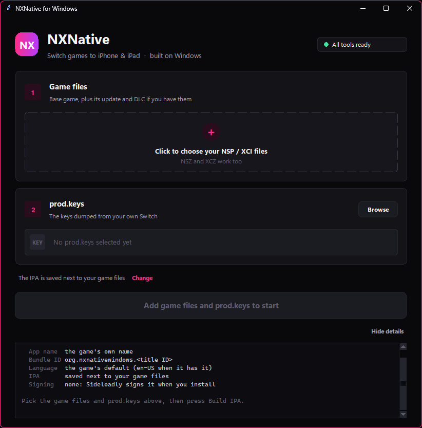
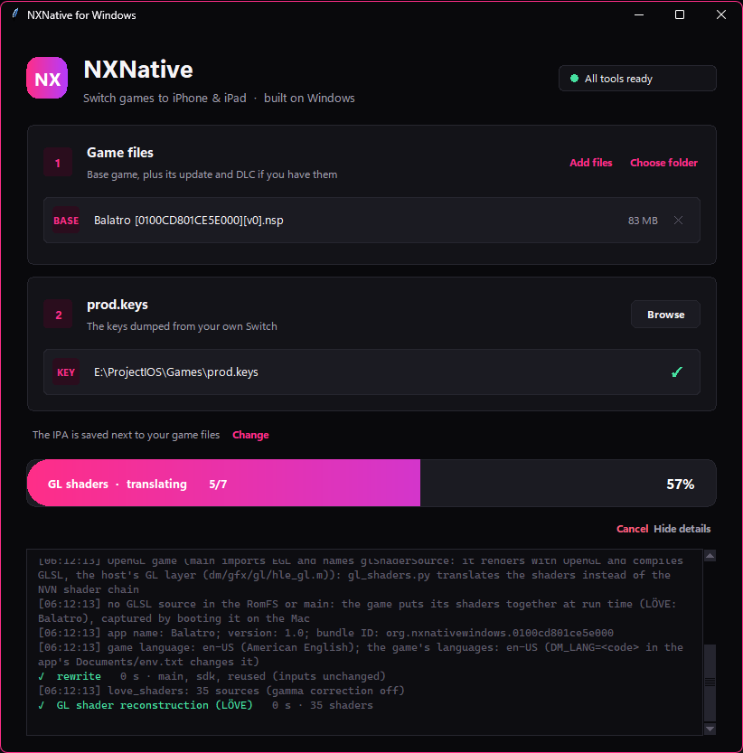
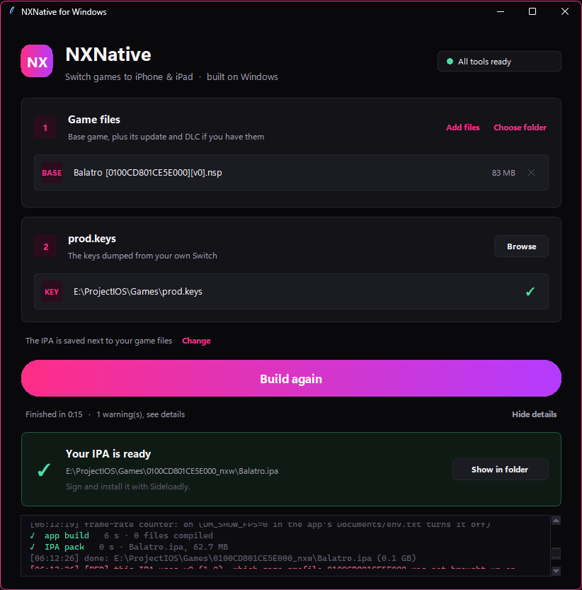
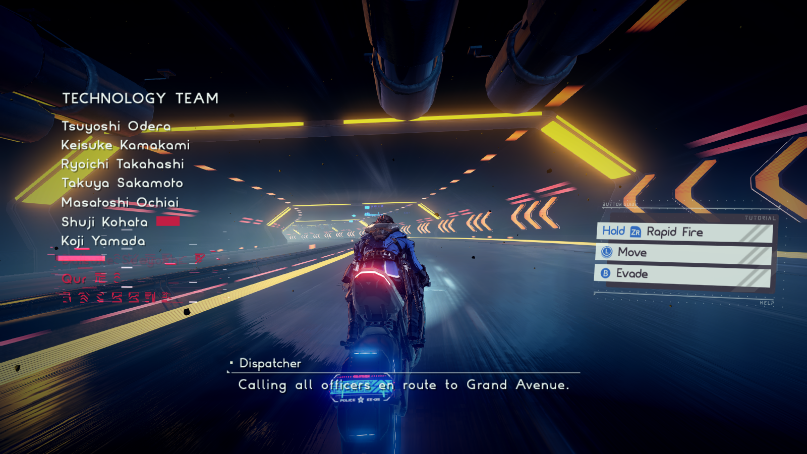
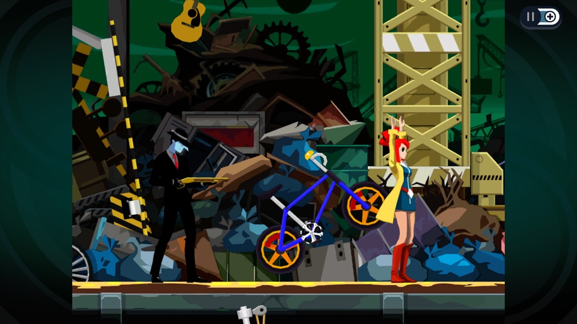
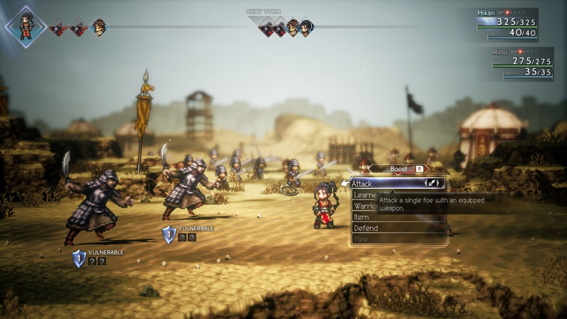

# NXNative for Windows

Build **nxnative** IPAs on a **Windows 10/11 PC, with no Mac**. Bring your own Nintendo Switch game (NSP / XCI) and your own `prod.keys`. Pick them in a window, press **Build IPA**, and sideload the IPA to your iPhone or iPad.

This repository is a fork of [seedds/nxnative](https://github.com/seedds/nxnative). nxnative is not an emulator: the game's own arm64 code runs directly on the Apple chip, and the Switch graphics are rebuilt on Metal. Upstream builds IPAs only on a Mac with Xcode. This fork adds a Windows build path in [`win/`](win/) and changes as little of upstream as it can. Nothing from any game is in this repository, and the project has no ties to Nintendo, Apple or any game publisher.

> Panduan langkah demi langkah dalam Bahasa Indonesia: [win/TUTORIAL.md](win/TUTORIAL.md).
> Upstream's own README (games gallery, Mac packing, playing) is kept as [README.nxnative.md](README.nxnative.md).

<p align="center">
  
  
  
</p>

## Contents

- [Status](#status)
- [Games](#games)
- [What you need](#what-you-need)
- [One-time setup](#one-time-setup)
- [Build an IPA with the window](#build-an-ipa-with-the-window)
- [Build an IPA from a terminal](#build-an-ipa-from-a-terminal)
- [Install the IPA on your iPhone or iPad](#install-the-ipa-on-your-iphone-or-ipad)
- [The launcher on the device](#the-launcher-on-the-device)
- [How the Windows build works](#how-the-windows-build-works)
- [Which games build on Windows](#which-games-build-on-windows)
- [Troubleshooting](#troubleshooting)
- [Differences from upstream](#differences-from-upstream)
- [Repository layout](#repository-layout)
- [Updating from upstream](#updating-from-upstream)
- [Credits and license](#credits-and-license)

## Status

| | |
|---|---|
| **Verified** | **Balatro** built on Windows 11, sideloaded, and played on an iPad (Apple A16 GPU, iPadOS 27). |
| **Built, under test** | **Megabyte Punch** (Unity 2019.2, no upstream profile yet). Its 3,498 NVN shaders compile with the Windows Metal compiler. The latest IPA has the SDK 8.3.1 address-region fix for its first crash. |
| **A16 and older GPUs** | Their GPUs cannot read BC-compressed textures, which most 3D Switch games ship. This fork decodes BC1–BC7 on the CPU at upload into uncompressed textures (`dm/gfx/tex/bc_soft.c`, checked block by block against a reference decoder). The upstream host stopped on them (`MTLTextureDescriptor has invalid pixelFormat`). Decoded textures take 4–8× the memory of the BC data, and big games may need *Increased Memory Limit*. |
| **Checked on Windows** | All 134 app sources compile against the iPhoneOS 27.1 SDK, and `ld64.lld` links the app with no undefined symbols. The shader chain's translator matches upstream's lock. Unit tests pass (`python win/tests/test_win.py`). |
| **Needs a Mac** | Games whose shaders exist only at run time, which upstream gets by booting the game in its Mac host: GLSLC capture, Vulkan capture, Unreal / Oodle decoding. See [Which games build on Windows](#which-games-build-on-windows). |

The PC this was built and tested on:

| Tool | Version |
|---|---|
| Windows | 11 Pro (x64) |
| Python | 3.15 |
| LLVM (clang, ld64.lld) | 23.1.4 |
| .NET SDK | 10.0.403 |
| Vulkan SDK (spirv-cross, glslangValidator) | 1.4.363.0 |
| zstd | 1.5.7 |
| Metal Developer Tools for Windows | 6.2 (`Apple metal version 32023.850`) |
| iPhoneOS SDK | 27.1, from `Xcode_27.1.xip` |

## Games

Upstream's 65 tested games, each with its IPA size. A note under a game is upstream's, for example "60 fps with 1.2.0" where the game runs at 60 fps with that update. The [per-game notes](dm/games/README.md#games) give each game's tested version, platforms and known issues. [Which games build on Windows](#which-games-build-on-windows) lists the few that still need a Mac for one build step.

<table>
<tr>
<td align="center" valign="top" width="33%"><br>Mario Kart 8 Deluxe<br><sub>~11.9 GB · no Mii heads</sub></td>
<td align="center" valign="top" width="33%"><br>Mario vs. Donkey Kong<br><sub>~1.6 GB</sub></td>
<td align="center" valign="top" width="33%"><br>Paper Mario: The Thousand-Year Door<br><sub>~5 GB · 60 fps with 1.0.1</sub></td>
</tr>
<tr>
<td align="center" valign="top" width="33%"><br>Super Mario 3D World + Bowser's Fury<br><sub>~3 GB</sub></td>
<td align="center" valign="top" width="33%"><br>Super Mario Bros. Wonder<br><sub>~4 GB</sub></td>
<td align="center" valign="top" width="33%"><br>Super Mario Galaxy<br><sub>~3 GB</sub></td>
</tr>
<tr>
<td align="center" valign="top" width="33%"><br>Super Mario Galaxy 2<br><sub>~3 GB</sub></td>
<td align="center" valign="top" width="33%"><br>Super Mario Odyssey<br><sub>~6 GB</sub></td>
<td align="center" valign="top" width="33%"><br>The Legend of Zelda: Breath of the Wild<br><sub>~16 GB · 60 fps with 1.9.0</sub></td>
</tr>
<tr>
<td align="center" valign="top" width="33%"><br>The Legend of Zelda: Link's Awakening<br><sub>~6 GB</sub></td>
<td align="center" valign="top" width="33%"><br>The Legend of Zelda: Tears of the Kingdom<br><sub>~17 GB · 60 fps with 1.4.3</sub></td>
<td align="center" valign="top" width="33%"><br>13 Sentinels: Aegis Rim<br><sub>~5 GB</sub></td>
</tr>
<tr>
<td align="center" valign="top" width="33%"><br>Absolum<br><sub>~2 GB</sub></td>
<td align="center" valign="top" width="33%"><br>Ace Attorney Investigations Collection<br><sub>~7 GB</sub></td>
<td align="center" valign="top" width="33%"><br>Advance Wars 1+2: Re-Boot Camp<br><sub>~7.1 GB</sub></td>
</tr>
<tr>
<td align="center" valign="top" width="33%"><br>AI: THE SOMNIUM FILES<br><sub>~8.3 GB</sub></td>
<td align="center" valign="top" width="33%"><br>AI: THE SOMNIUM FILES - nirvanA Initiative<br><sub>~11.6 GB</sub></td>
<td align="center" valign="top" width="33%"><br>Animal Crossing: New Horizons<br><sub>~10.5 GB</sub></td>
</tr>
<tr>
<td align="center" valign="top" width="33%"><br>ANIMAL WELL<br><sub>~54 MB</sub></td>
<td align="center" valign="top" width="33%"><br><a href="dm/games/01007300020FA000/README.md">ASTRAL CHAIN</a><br><sub>~9.7 GB · 60 fps target with 1.0.1</sub></td>
<td align="center" valign="top" width="33%"><br>Balatro<br><sub>~82 MB · played by touch</sub></td>
</tr>
<tr>
<td align="center" valign="top" width="33%"><br>BALL x PIT<br><sub>~1.1 GB</sub></td>
<td align="center" valign="top" width="33%"><br>Bayonetta<br><sub>~8.8 GB</sub></td>
<td align="center" valign="top" width="33%"><br>Bayonetta 2<br><sub>~12.5 GB</sub></td>
</tr>
<tr>
<td align="center" valign="top" width="33%"><br>Bayonetta 3<br><sub>~14.2 GB</sub></td>
<td align="center" valign="top" width="33%"><br>Big Brain Academy: Brain vs. Brain<br><sub>~0.8 GB</sub></td>
<td align="center" valign="top" width="33%"><br>Brain Memory Training Academy<br><sub>~0.1 GB</sub></td>
</tr>
<tr>
<td align="center" valign="top" width="33%"><br>Captain Toad: Treasure Tracker<br><sub>~2 GB</sub></td>
<td align="center" valign="top" width="33%"><br>Catherine: Full Body<br><sub>~14 GB</sub></td>
<td align="center" valign="top" width="33%"><br>Celeste<br><sub>~0.9 GB</sub></td>
</tr>
<tr>
<td align="center" valign="top" width="33%"><br>Cuphead<br><sub>~5 GB</sub></td>
<td align="center" valign="top" width="33%"><br>DARK SOULS: REMASTERED<br><sub>~4 GB · 60 fps with 1.0.3</sub></td>
<td align="center" valign="top" width="33%"><br>Digimon Story Cyber Sleuth: Complete Edition<br><sub>~5 GB</sub></td>
</tr>
<tr>
<td align="center" valign="top" width="33%"><br>DRAGON QUEST VII Reimagined<br><sub>~5.9 GB</sub></td>
<td align="center" valign="top" width="33%"><br>DRAGON QUEST XI S: Echoes of an Elusive Age – Definitive Edition<br><sub>~15 GB · 60 fps with 1.0.4</sub></td>
<td align="center" valign="top" width="33%"><br>FINAL FANTASY RESONANCE<br><sub>~10 GB · 60 fps with 1.0.1</sub></td>
</tr>
<tr>
<td align="center" valign="top" width="33%"><br>FINAL FANTASY TACTICS - The Ivalice Chronicles<br><sub>~11 GB</sub></td>
<td align="center" valign="top" width="33%"><br>Fire Emblem Engage<br><sub>~15 GB · 60 fps with 2.0.0</sub></td>
<td align="center" valign="top" width="33%"><br>Fire Emblem: Three Houses<br><sub>~13 GB · 60 fps with 1.2.0</sub></td>
</tr>
<tr>
<td align="center" valign="top" width="33%"><br>Ghost Trick: Phantom Detective<br><sub>~3 GB</sub></td>
<td align="center" valign="top" width="33%"><br>The Great Ace Attorney Chronicles<br><sub>~4 GB</sub></td>
<td align="center" valign="top" width="33%"><br>Hades<br><sub>~4 GB</sub></td>
</tr>
<tr>
<td align="center" valign="top" width="33%"><br>Hades II<br><sub>~4 GB</sub></td>
<td align="center" valign="top" width="33%"><br>Hollow Knight: Silksong<br><sub>~6.4 GB</sub></td>
<td align="center" valign="top" width="33%"><br>Hyrule Warriors: Age of Calamity<br><sub>~15 GB · 60 fps with 1.3.0</sub></td>
</tr>
<tr>
<td align="center" valign="top" width="33%"><br>Luigi's Mansion 3<br><sub>~7.5 GB · 60 fps with 1.4.0</sub></td>
<td align="center" valign="top" width="33%"><br>Metroid Dread<br><sub>~5 GB</sub></td>
<td align="center" valign="top" width="33%"><br>Monster Hunter Rise<br><sub>~22 GB · 60 fps with 16.0.2</sub></td>
</tr>
<tr>
<td align="center" valign="top" width="33%"><br>Monster Train 2<br><sub>~1.6 GB · 60 fps with 1.1.1</sub></td>
<td align="center" valign="top" width="33%"><br>Octopath Traveler 0<br><sub>~4 GB · 60 fps with 1.0.5</sub></td>
<td align="center" valign="top" width="33%"><br>Octopath Traveler II<br><sub>~5.9 GB · 60 fps with 1.1.1</sub></td>
</tr>
<tr>
<td align="center" valign="top" width="33%"><br>Patrick's Parabox<br><sub>~0.2 GB</sub></td>
<td align="center" valign="top" width="33%"><br>Persona 5 Royal<br><sub>~14.9 GB</sub></td>
<td align="center" valign="top" width="33%"><br>Pikmin 4<br><sub>~10.8 GB</sub></td>
</tr>
<tr>
<td align="center" valign="top" width="33%"><br>Pokémon Legends: Z-A<br><sub>~6 GB</sub></td>
<td align="center" valign="top" width="33%"><br>Pokémon Sword<br><sub>~12.4 GB</sub></td>
<td align="center" valign="top" width="33%"><br>Portal<br><sub>~2.6 GB</sub></td>
</tr>
<tr>
<td align="center" valign="top" width="33%"><br>Raging Loop<br><sub>~0.9 GB</sub></td>
<td align="center" valign="top" width="33%"><br>Rhythm Heaven Groove<br><sub>~3 GB</sub></td>
<td align="center" valign="top" width="33%"><br>ROMANCE OF THE THREE KINGDOMS 8 REMAKE<br><sub>~16.8 GB · controller only</sub></td>
</tr>
<tr>
<td align="center" valign="top" width="33%"><br>Stardew Valley<br><sub>~0.6 GB</sub></td>
<td align="center" valign="top" width="33%"><br>STEINS;GATE RE:BOOT<br><sub>~6 GB</sub></td>
<td align="center" valign="top" width="33%"><br>Super Smash Bros. Ultimate<br><sub>~17.5 GB · offline</sub></td>
</tr>
<tr>
<td align="center" valign="top" width="33%"><br>Taiko Risshiden V DX<br><sub>~3.3 GB · Japanese · played by touch</sub></td>
<td align="center" valign="top" width="33%"><br>Unicorn Overlord<br><sub>~4 GB</sub></td>
</tr>
</table>

## What you need

- **A Windows 10 or 11 PC (x64)** with free disk space of about twice your NSPs plus 10 GB. The SDK and tools take about 5 GB more.
- **An iPhone or iPad on iOS / iPadOS 26 or later.** An **A17 Pro or newer** iPhone, or an **M1 or newer** iPad, reads the games' BC-compressed textures on the GPU. On an **A16 or older** chip this fork decodes them on the CPU: it is slower to load, and textures take more memory. Tested on an iPad with an A16.
- **Your own game dump** (NSP, XCI, NSZ or XCZ: the base game, plus its update and DLC if you have them) and **your own `prod.keys`**.
- **A free Apple ID**, for two downloads from Apple (below) and for signing with Sideloadly.

## One-time setup

### 1. Tools from winget and pip

Open **PowerShell** and run:

```
winget install --id LLVM.LLVM -e
winget install --id Microsoft.DotNet.SDK.10 -e
winget install --id KhronosGroup.VulkanSDK -e
winget install --id Meta.Zstandard -e
python -m pip install lz4 capstone fonttools pillow "backports.zstd; python_version < '3.14'"
```

You need Python 3.10 or later from [python.org](https://www.python.org/downloads/). Check "Add python.exe to PATH" when you install it.

### 2. Two downloads from Apple

Sign in at [developer.apple.com/download](https://developer.apple.com/download/all/) with your Apple ID:

1. **Metal Developer Tools for Windows** (version 5.x or 6.x). Install it anywhere, for example `E:\ProjectIOS\Metal Developer Tools`. It compiles the shader libraries.
2. **Xcode 26 or 27** (`Xcode_27.1.xip`, about 2 GB). Only its iPhoneOS SDK is used. Extract it once (one to two minutes):

   ```
   cd E:\ProjectIOS\nxnative-win
   python win\sdk\extract_xip.py E:\ProjectIOS\Xcode_27.1.xip
   ```

   The SDK lands in `win\sdk\out\iPhoneOS.sdk`. Copying `iPhoneOS.sdk` from a Mac works too.

Apple's Xcode and Apple SDKs Agreement covers these files. Read it before you use them on non-Apple hardware.

### 3. Get this repository

```
git clone https://github.com/zenvyzenshiro/NXNativeWindows.git E:\ProjectIOS\nxnative-win
```

Keep the checkout's line endings as they are. `.gitattributes` turns Git's CRLF conversion off, because the shader chain hashes source bytes.

### 4. Tell the build where the tools are

Copy `win\toolchain.example.json` to `win\toolchain.json` and fix the paths. Tools in their default install folders are found without it. For example:

```json
{
  "llvm": "C:\\Program Files\\LLVM",
  "metal_tools": "E:\\ProjectIOS\\Metal Developer Tools",
  "ios_sdk": "E:\\ProjectIOS\\nxnative-win\\win\\sdk\\out\\iPhoneOS.sdk",
  "spirv_cross_dir": "C:\\VulkanSDK\\1.4.363.0\\Bin",
  "glslangValidator_dir": "C:\\VulkanSDK\\1.4.363.0\\Bin"
}
```

Every key can also be set as an environment variable `NXW_<KEY>`, for example `NXW_IOS_SDK`.

### 5. Check everything

```
python win\doctor.py
```

Every line should read `[ok ]`, ending with `everything a build needs is there`. A missing tool prints where to get it.

## Build an IPA with the window

Double-click **`Build-IPA-GUI.bat`** in the repository folder.

1. **Game files**: click the dashed box to pick your NSP / XCI files (base, update and DLC of one game), or use *Choose folder*. Each file shows as BASE, UPD or DLC with its size. *✕* removes one.
2. **prod.keys**: click *Browse*. The window finds `prod.keys` by itself when it sits next to the game files.
3. Click **Build IPA**. The button turns into the progress bar (stage, step, percentage). A green card then shows the IPA, and *Show in folder* opens it.

Every build uses the defaults. *Details*, shown from the start, lists them:

- App name: the game's own name
- Bundle ID: `org.nxnativewindows.<title ID>`
- Language: the game's default
- IPA: saved next to your game files (*Change* picks another path)
- Signing: none (Sideloadly signs the IPA when you install it)

When the folder you pick also holds another game's files, the window hard-links the chosen files into a folder of their own (`<title ID>_nxw`, next to them). The pipeline packs every game file in its folder, so this keeps the games apart, and hard links take no extra disk space.

## Build an IPA from a terminal

```
cd E:\ProjectIOS\nxnative-win
python win\build_ipa_windows.py "E:\ProjectIOS\Games\MarioWonder" -k "E:\ProjectIOS\Games\prod.keys"
```

Put one game per folder. The IPA appears in that folder (for example `SMBWMobile.ipa`). The work folder `<title ID>_build\` stays next to it, so later builds of the same game take seconds to minutes, and each stage writes its full log to `<title ID>_build\logs\`.

The options are upstream's (`-h` lists them all):

| Option | Effect |
|---|---|
| `-o D:\out\Game.ipa` | where the IPA goes |
| `--app-name "Name"` | the name on the home screen |
| `--bundle-id com.you.game` | another bundle ID (default `org.nxnativewindows.<title ID>`) |
| `-l ja` | the game language packed into the app |
| `--show-fps` / `--no-show-fps` | the frame-rate counter's default |
| `--keep-extracted` / `--no-keep-extracted` | keep or delete the extracted game files after the build |
| `--env-file my_env.txt` | diagnostic environment variables baked into the app |

Only `--platform ios` builds on Windows. `--prepare-xcode` and the Mac platforms need a Mac.

## Install the IPA on your iPhone or iPad

1. Install **[Sideloadly](https://sideloadly.io/)** on Windows. When it asks, also install iTunes and iCloud from Apple's website, not the Microsoft Store versions.
2. Connect the device, drag the `.ipa` onto Sideloadly, enter your Apple ID and press **Start**. Leave Sideloadly's *Bundle ID* and *App Name* fields empty, so the values from the build are kept.
3. In *Advanced options*, enable **Increased Memory Limit** when Sideloadly offers it. Without it iOS gives the app about 3.4 GB and closes the bigger games; with it a recent device gives about 6 GB.
4. On the device, turn on **Settings → Privacy & Security → Developer Mode** and restart. Then trust your Apple ID under **Settings → General → VPN & Device Management**.
5. Open the app: the launcher appears, then press **Play**.

With a free Apple ID the app must be signed again every 7 days.

## The launcher on the device

The settings screen before the game starts looks like upstream's original SwiftUI launcher. The game card sits on the left half and the settings on the right half, one rounded row per setting. On Windows it is drawn by [`win/ios/Launcher.m`](win/ios/Launcher.m), a UIKit port, so no Swift toolchain is needed. Choices are kept between launches.

| Setting | What it does |
|---|---|
| **Frame rate** | *Game default*, 30 fps or 60 fps. Games with an upstream 60 fps patch (Tears of the Kingdom, Breath of the Wild, …) default to their profile's choice. |
| **Render scale** | 50–100 % of the game's render size. It works only in games whose rewriter has a render-scale stub (Tears of the Kingdom, Breath of the Wild). In other games it is greyed out with "No effect in this game". |
| **Frame buffering** | NVN games: may reduce stutter, adds display latency. |
| **Console mode** | *Docked* by default. Touch games such as Balatro default to *Handheld*, because their touches reach the game only in handheld mode. |
| **Game language** | The Switch system language, among the languages the game's control data declares. Some games (Balatro) declare only English and choose their language in their own options menu instead. |
| **Frame-rate counter**, **Performance HUD** | on-screen FPS and Metal's HUD |
| **Touch feedback**, **Game rumble**, **Rumble strength** | haptics |

An `env.txt` in the app's Documents folder (Files app) still overrides any setting, as upstream documents.

## How the Windows build works

`win/build_ipa_windows.py` runs upstream's own pipeline (`scripts/build_ipa_from_nsp.py`) unchanged. Only the steps that call macOS tools are replaced, at the subprocess boundary:

| Step | Upstream on a Mac | NXNative for Windows |
|---|---|---|
| Extract NSP / XCI (LibHac) | `nx_extract` (.NET) | the same, built with the .NET SDK for Windows |
| Rewrite the game modules | `patch_nso.py` | the same |
| Translate shaders (Ryujinx) | `dmsh_xlate` apphost | the same locked DLLs through `dotnet dmsh_xlate.dll`, so the chain's fingerprints still match `dmsh_chain.lock` |
| Compile shader libraries | `xcrun metal` / `metallib` (Xcode) | Metal Developer Tools for Windows, through [`win/xcrun.py`](win/xcrun.py) (`-mios-version-min` becomes `-target air64-apple-ios…`) |
| Build the app | `xcodegen` + `xcodebuild` | LLVM `clang -target arm64-apple-ios26.0 -isysroot iPhoneOS.sdk`, linked by `ld64.lld` ([`win/build_app.py`](win/build_app.py)) |
| Launcher | `Launcher.swift` (SwiftUI) | [`win/ios/Launcher.m`](win/ios/Launcher.m) (UIKit, same contract) |
| `@available` runtime | Apple's compiler-rt | [`win/ios/compat_rt.c`](win/ios/compat_rt.c) |
| App icon | `actool` asset catalog | PNG icons in `CFBundleIcons` (Pillow) |
| `sips`, `plutil`, `make -n` | macOS tools | Pillow, `plistlib`, the Makefile's source rules reproduced (the build stops if they change) |
| Executable's x bit in the IPA | Unix modes | `pack_ipa.py --exec` (Windows has no Unix modes) |
| iPhoneOS SDK | inside Xcode | [`win/sdk/extract_xip.py`](win/sdk/extract_xip.py) reads `Xcode.xip` (xar → pbzx → cpio), including Xcode 27's deduplicated archive, whose hard links hold `NULLcanary` placeholders |
| Run-time GL shaders of LÖVE games | boot the game in the Mac host (`DM_GL_CAPTURE`) | [`win/love_shaders.py`](win/love_shaders.py) assembles the same GLSL offline from the Lua that love-nx embeds in `main`. LÖVE's defaults match upstream's capture table byte for byte, and all 31 keys an iPad run asked for match. |
| Heap check of a new game | boot it in the Mac host | an estimate: a 2 GB application pool for games with virtual address memory, stamped into the profile |
| Address-region cuts for an unregistered `sdk` build | added by hand per build ID | [`win/sdk_auto_cuts.py`](win/sdk_auto_cuts.py) finds them from the code (the `AddressRegionManager` constructor's node-area loads and the 1 GB alignment), only when the match is unique |

[`win/pyshim/sitecustomize.py`](win/pyshim/sitecustomize.py) loads in every Python the pipeline starts. It maps `xcrun`, `dmsh_xlate`, `which`, `python3` and `bash build_ipa.sh` to their Windows counterparts, and makes `ctypes.CDLL(None)` safe. The technical notes are in [win/README.md](win/README.md).

## Which games build on Windows

Upstream lists about 65 playable games in its [games table](dm/games/README.md#games), with each game's tested version. On Windows:

- **Most games build as on a Mac.** Examples: Super Mario Bros. Wonder, Super Mario Odyssey, Mario Kart 8 Deluxe, Zelda: Breath of the Wild and Tears of the Kingdom.
- **LÖVE games** (Balatro) build: their run-time shaders are rebuilt offline.
- **These still need a Mac with Apple silicon**, because one step boots the game's own code in the Mac host. The Windows build stops with a message naming the step:
  - games that compile shaders at run time with GLSLC (Fire Emblem: Three Houses)
  - Vulkan games that generate their shaders (Super Mario Galaxy)
  - games with Oodle or Unreal shader archives (Pokémon Legends: Z-A, PlatinumGames' PKZ games, DRAGON QUEST XI S, …)
- **Games without an upstream profile** (Megabyte Punch) get a provisional profile guessed from a survey. The IPA is a best effort and may not boot until the game is brought up ([docs/agents](docs/agents/README.md)).
- **Use the tested version.** Another version builds with its own shaders, but the fixes made for the tested build (60 fps patches and others) do not apply, and the build says so.

## Troubleshooting

| Message or symptom | What to do |
|---|---|
| `doctor.py` shows `MISSING` | Install what the `get it:` line names, or set its path in `win\toolchain.json`. |
| `run-time shader capture … needs a Mac with Apple silicon` | This game needs a Mac for one step (see above). |
| `[RED] this IPA uses vX, which game profile … was not brought up on` | Put the update named in upstream's games table in the same folder and build again. |
| `[RED] provisional game profile …` | The game has no upstream profile: the IPA may not boot. Send the device log (below). |
| The app closes right after *Play* | Open the **Files** app → *On My iPhone/iPad* → the game → `log.txt` (and `log.prev.txt`), and look at its last lines. [docs/agents/symptoms.md](docs/agents/symptoms.md) indexes known messages. |
| A 3D game closes while loading on an older device | BC textures are decoded on the CPU there and take more memory: sign with *Increased Memory Limit*. `log.txt` says `BC textures: decoded on the CPU` when the fallback is on. |
| The name or bundle ID on the device differs from the build | Leave Sideloadly's *App Name* / *Bundle ID* fields empty. |
| A stage failed | Its full log is in `<title ID>_build\logs\` next to the game files. |

## Differences from upstream

- **Windows build path** in [`win/`](win/), and the window `Build-IPA-GUI.bat`.
- **Default bundle ID `org.nxnativewindows.<title ID>`** in every build path, so these apps install beside upstream-built ones.
- **Launcher settings for every game**: Frame rate (with *Game default*), Render scale (greyed out where it does nothing), Console mode (docked by default, handheld for touch games) and Game language are always listed ([`dm/games/settings.tsv`](dm/games/settings.tsv)).
- **Derived profiles** get a RomFS marker that their version has (Balatro v0 lacks 1.1.3's marker file).
- **`pack_ipa.py --exec`** sets the executable's mode when packing on Windows.
- **`.gitattributes`** keeps every file byte-identical to upstream on Windows, and the shim writes every pipeline text file with LF line ends, as on a Mac. With CRLF, the host refused the shader libraries' stamp.
- **BC textures on GPUs without BC** (A16 and older) are decoded on the CPU ([`dm/gfx/tex/bc_soft.c`](dm/gfx/tex/bc_soft.c); `DM_BC_SOFT=1` forces it, `=0` turns it off).
- **Address-region cuts for unregistered `sdk` builds** are found from the code ([`win/sdk_auto_cuts.py`](win/sdk_auto_cuts.py)).

## Repository layout

| Path | What it is |
|---|---|
| `Build-IPA-GUI.bat` | starts the window |
| `win/gui.pyw` | the window (Tkinter, black and pink) |
| `win/build_ipa_windows.py` | the Windows driver around upstream's NSP script |
| `win/build_app.py` | the app build that replaces `build_ipa.sh` / Xcode |
| `win/xcrun.py`, `win/toolchain.py` | the `xcrun` stand-in and the tool locator |
| `win/pyshim/sitecustomize.py` | the subprocess shim loaded by every pipeline Python |
| `win/ios/Launcher.m`, `win/ios/compat_rt.c` | the UIKit launcher and the `@available` runtime |
| `win/love_shaders.py` | LÖVE run-time shaders, offline |
| `win/sdk_auto_cuts.py` | address-region cuts for unregistered `sdk` builds |
| `win/sdk/extract_xip.py` | iPhoneOS SDK from `Xcode.xip` |
| `win/doctor.py`, `win/compile_check.py` | toolchain check; compile every app source without game files |
| `win/tests/test_win.py` | unit tests of the Windows parts |
| `win/TUTORIAL.md` | the step-by-step guide in Indonesian |
| `win/README.md` | technical notes on the port |
| everything else | upstream nxnative ([README.nxnative.md](README.nxnative.md), [docs/development.md](docs/development.md)) |

Local files git ignores: `win/toolchain.json`, `win/gui_settings.json`, `win/sdk/out/` (the extracted SDK) and `win/build/`.

## Updating from upstream

```
git remote add upstream https://github.com/seedds/nxnative.git
git fetch upstream
git merge upstream/main
python win\tests\test_win.py
python win\compile_check.py
```

`win/build_app.py` checks `dm/host/Makefile`'s source rules and stops with a clear message when upstream changes them.

## Credits and license

- **[seedds/nxnative](https://github.com/seedds/nxnative)** and everything it builds on: [d2r-mobile](https://github.com/jhaizhou-ops/d2r-mobile), Ryujinx, Atmosphère, yuzu, LibHac, SPIRV-Cross, glslang, deko3d and the libraries in `dm/third_party` (see [README.nxnative.md](README.nxnative.md#acknowledgements)).
- **Apple's** Metal Developer Tools for Windows and iPhoneOS SDK are downloaded by each user under Apple's terms and are not part of this repository.
- **[LLVM](https://llvm.org/)** (clang, ld64.lld) builds the app on Windows.

MIT License, as upstream ([LICENSE](LICENSE)). Play only games you own, with keys from your own console.
